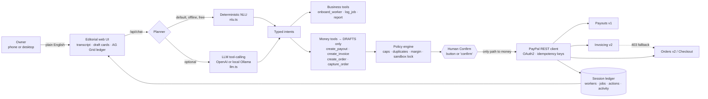

# JobPay Agent

**The AI back office for home-service crews. You describe a finished job in plain English. The agent pays your worker with PayPal Payouts and bills your customer with PayPal Invoicing or Checkout. Every dollar is policy-checked and human-approved.**

> PayPal AI Hackathon 2026 · MIT · runs fully offline in dry-run, or against the PayPal **sandbox** with your app keys.


---

## The problem

Home-service businesses (plumbers, cleaners, landscapers, handymen) often run on crews of independent contractors. At the end of a long day the owner finishes a long day and still has to:

1. work out what each worker is owed (hours × rate, or a flat rate per job),
2. pay them quickly so they keep picking up shifts,
3. bill the customer, chase the payment, and
4. work out whether the job made money.

Today that means texts, a spreadsheet, a PayPal tab, an invoicing tab and guesswork. Payroll tools are built for W-2 staff and invoicing tools don't know who did the job. **Nothing closes out a job end to end.**

## Who it's for

Owner-operators with **2–25 contractors**, such as a cleaning company in Raleigh or a two-truck plumbing shop, who already use PayPal to get paid and want the money side done in one sentence from their phone.

## What it does

```
“Maria finished the water heater repair for Bob Smith bob.smith@example.com, 3 hours, charge $240”
```

From that one message, the agent:

| Step | What happens | PayPal API |
|---|---|---|
| 1. Understand | Parses the worker, customer, hours and price, and looks up Maria's rate ($45/hr) | — |
| 2. Log the job | Creates a job record and computes pay **$135** and margin **$105 (44%)** | — |
| 3. Plan the close-out | Drafts a **payout to Maria** and an **invoice to Bob** | — |
| 4. Policy check | Per-payout cap, daily cap, crew membership, duplicate-payment and negative-margin checks, sandbox lock | — |
| 5. **Human approves** | You press **Confirm & send** on each card, or say “confirm all” | — |
| 6. Execute | Sends the payout and the invoice, both idempotent | `POST /v1/payments/payouts`, `POST /v2/invoicing/invoices` + `/send` |
| 7. Self-heal | If Invoicing isn't enabled on the app, it creates a **PayPal Checkout link** instead | `POST /v2/checkout/orders` |
| 8. Reconcile | Live status in the ledger and the books (paid, billed, margin, top earners, who still owes you) | `GET /v1/payments/payouts/{id}`, `GET /v2/invoicing/invoices/{id}`, `GET /v2/checkout/orders/{id}` |

It also handles:

- **Onboarding.** For example: “Onboard Dev Patel, handyman, dev.patel@example.com, $60 per job”.
- **Ad-hoc payouts and payment links.**
- **Capturing approved orders.**
- **Multi-turn slot filling.** If you say “Pay Jane $50”, the agent asks “What's Jane's PayPal email?”, and your next message fills in the draft.
- **Compound instructions.** For example: “pay Maria $80 then invoice Ana $120 for tile work”.

## Demo in 60 seconds

```bash
curl -fsSL https://bun.sh/install | bash        # if you don't have Bun (free)
git clone https://github.com/godbody4040-oss/JobPay-Agent.git && cd JobPay-Agent
bun install
bun run start                                    # → http://localhost:3000
```

There are no keys to set up. Without credentials the app runs in **DRY-RUN** mode: every flow, card, policy check and ledger row works, and the exact PayPal request bodies are shown. To hit the real PayPal **sandbox**:

```bash
cp .env.example .env    # add PAYPAL_CLIENT_ID / PAYPAL_CLIENT_SECRET from a sandbox app
bun run start           # GET /health → "paypalCredentials": true
bun run smoke           # scripted end-to-end run: onboard → close out → pay + bill → status → books (at most $5 of sandbox money)
bun test                # 13 tests, forced dry-run
```

**Click path:** **Load demo crew** → tap the amber chip (*“Maria finished the water heater repair…”*) → **Confirm & send** on both cards → **↻ Live PayPal status** → *“Show my books”*. The 90-second script is in [JUDGES.md](JUDGES.md).

## Architecture



| File | Role |
|---|---|
| `src/nlu.ts` | Offline planner: amounts (`$1,250.50`), rates (`$45/hr`), hours, names, emails, compound clauses, confirm/cancel |
| `src/llm.ts` | Optional OpenAI-compatible tool-calling planner. Same intents, timeout, automatic fallback |
| `src/tools.ts` | Tool manifest (`GET /api/tools`). PayPal tool names mirror the official **PayPal Agent Toolkit** |
| `src/agent.ts` | Orchestrator: intents → tools → drafts → `confirmAction()` (the **only** function that calls money-moving endpoints) |
| `src/policy.ts` | Spend policy, re-evaluated when you confirm |
| `src/paypal.ts` | REST client: OAuth2 token cache, `PayPal-Request-Id` idempotency, sandbox lock, realistic dry-run |
| `src/ledger.ts` | Session state: crew, jobs, money actions, activity feed, totals |
| `public/` | No-build UI: vanilla JS, AG Grid Community from CDN with an offline table fallback |

## PayPal APIs used

| API | Endpoint | Used for |
|---|---|---|
| OAuth 2.0 | `POST /v1/oauth2/token` | Client-credentials token, cached until expiry |
| **Payouts** | `POST /v1/payments/payouts` | Paying workers. `sender_batch_id` and `PayPal-Request-Id` keep retries from paying twice |
| | `GET /v1/payments/payouts/{batch_id}` | Batch and item status in the ledger |
| **Invoicing v2** | `POST /v2/invoicing/invoices`, `POST …/{id}/send`, `GET …/{id}` | Billing customers with a due date, line item and reference to the job |
| **Orders v2** | `POST /v2/checkout/orders` (`intent: CAPTURE`, `payer-action` link) | Pay-now checkout links and the invoicing fallback |
| | `GET /v2/checkout/orders/{id}`, `POST …/{id}/capture` | Tracking and capturing (capture is human-gated) |

**Verified against the live PayPal sandbox** (Nov 5, 2026):

- Payout batches were created and returned `PENDING` (for example `EQJADRKGX6CUU`).
- Orders were created and returned `PAYER_ACTION_REQUIRED` with a working checkout link.
- Invoicing returned `403 NOT_AUTHORIZED` on our sandbox app because the *Invoicing* feature wasn't enabled. The agent automatically fell back to Orders, and you can see this in the trace.

## How the AI works

- **The planner turns language into typed intents.** By default it is a deterministic, offline NLU. It needs no API key, adds no latency and costs nothing, so the demo can't break. Set `OPENAI_API_KEY` (or `OPENAI_BASE_URL` pointing at **Ollama/LM Studio** for a free local model) and an LLM plans with **function/tool calling** over the same tool manifest. On any error or timeout it falls back to the offline planner.
- **Agentic, not chatty.** One sentence becomes a multi-step plan: log job → compute pay from the rate → compute margin → draft the payout and the bill → policy → approval → execution → reconciliation.
- **Session state.** The agent remembers your crew and rates, recent jobs and half-finished requests across turns.
- **Agent trace.** Every reply shows the tools it called, how long each took and what it returned, so judges can see the agent work.

## Security and safety

- **The model never moves money.** Money tools only create drafts. `confirmAction()` runs only when a human clicks **Confirm** or types an explicit confirmation. The PayPal helpers also throw unless `confirmed: true` is passed (this is covered by the tests).
- **The spend policy is re-checked at execution:**
  - per-payout cap
  - daily cap
  - invoice cap
  - duplicate payment for the same job is blocked
  - recipients outside the crew are flagged
  - negative margin is flagged
- **Sandbox lock.** `PAYPAL_MODE=live` is refused in code.
- **Idempotency.** Every money call carries `PayPal-Request-Id`, so retries are safe.
- **Secrets.** These stay in `.env` only, which is git-ignored and Docker-ignored. Secrets are never logged and never sent to the browser or the LLM.
- **Hardening.** There is a per-IP rate limit, a 64 KB body limit, `nosniff` and `no-referrer` headers, and HTML is escaped in the UI.

## Deploy free on Render

The repo ships a `Dockerfile` and a `render.yaml` Blueprint for a **Render free web service**. Choose the **Free** instance type.

1. Fork or clone this repo to your GitHub.
2. In Render: **New → Blueprint** (or **New → Web Service → Build from a Git repo**), and pick the repo. Render reads `render.yaml`: Docker runtime, `plan: free`, health check `/health`.
3. Environment variables are optional. Leave them empty for a public **dry-run** demo, or add **sandbox** `PAYPAL_CLIENT_ID` / `PAYPAL_CLIENT_SECRET`. `PORT` is injected by Render, and `RENDER_EXTERNAL_URL` is used automatically as the PayPal checkout return URL.
4. Deploy, then open `https://<your-service>.onrender.com/health`.

Free instances sleep when idle, so the first request after a nap takes about 30–60 s.

## API

```
GET  /health                       → { ok, paypalCredentials, mode, dryRun, planner, limits }
GET  /api/tools                    → tool manifest (names, JSON schemas, PayPal endpoint, gate)
GET  /api/state?sessionId=…        → crew, jobs, actions, activity, totals, messages
POST /api/chat        {sessionId, message}
POST /api/actions/:id/confirm {sessionId}   ← the only route to money movement
POST /api/actions/:id/cancel  {sessionId}
POST /api/refresh     {sessionId}  → live PayPal status for everything sent
POST /api/reset       {sessionId}
```

## Hackathon checklist

- [x] Meaningful PayPal integration: Payouts, Invoicing and Orders (create, get, capture), OAuth and idempotency
- [x] Meaningful AI: an agentic planner (offline NLU plus optional LLM tool-calling), multi-step plans and multi-turn state
- [x] Working prototype: `bun install && bun run start`, dry-run without keys, live sandbox with keys
- [x] Setup and run instructions (above) plus `bun run smoke` for an end-to-end proof
- [x] Tools disclosed: PayPal REST APIs, an optional OpenAI-compatible LLM, Bun, Express and AG Grid Community
- [x] Public repo, MIT license
- [x] Free Render deploy path (`render.yaml` and `Dockerfile`)
- [ ] Demo video under 3 minutes on YouTube (script in [JUDGES.md](JUDGES.md))

## Sponsor tools

- **AG Grid Community.** It powers the live **Ledger**: sortable and filterable payout, invoice and order history; signed, color-coded amounts; status color rules; and a pinned *Net cash* total row in a custom dark Quartz theme that matches the editorial UI. If the CDN is unreachable, it falls back to a plain table.
- **Render.** One-click free deploy with the `render.yaml` Blueprint and `Dockerfile`.

## Roadmap

- PayPal webhooks (`PAYMENT.PAYOUTS-ITEM.SUCCEEDED`, `INVOICING.INVOICE.PAID`) to auto-close jobs
- Batch Friday payroll (one Payouts batch, many items)
- Persistent storage (SQLite or Postgres) and multi-user auth
- Swapping the REST layer for `@paypal/agent-toolkit` or the PayPal MCP server. The tool names already match.

## License

MIT. See [LICENSE](LICENSE).
