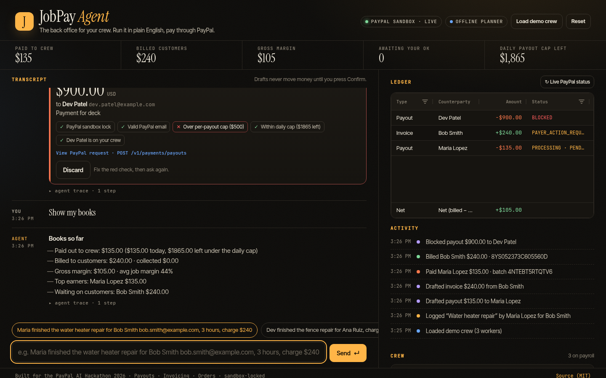
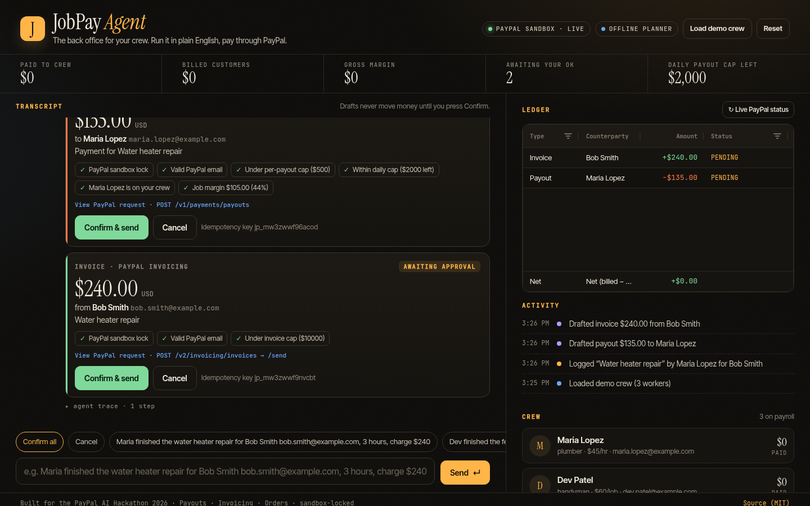
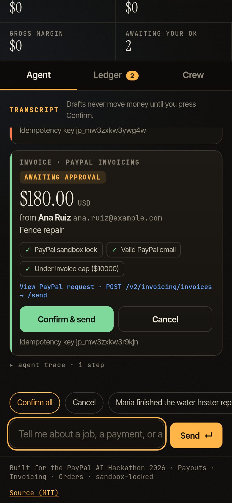
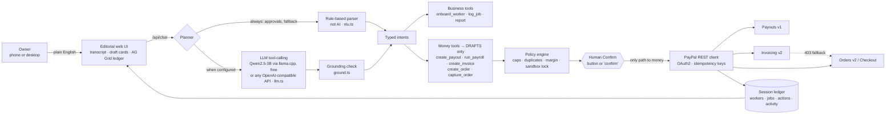

# JobPay Agent

**The AI back office for home-service crews. You describe a finished job in plain English. The agent pays your worker with PayPal Payouts and bills your customer with PayPal Invoicing or Checkout. Every dollar is policy-checked and human-approved.**

> PayPal AI Hackathon 2026 · MIT · **Live demo (public, dry-run): https://jobpay-agent.onrender.com** · runs offline in dry-run, against the PayPal **sandbox** with your app keys, and with a free local LLM (Qwen2.5-3B via llama.cpp) for AI planning.



<p align="center"> </p>

---

## The problem

Home-service businesses (plumbers, cleaners, landscapers, handymen) often run on crews of independent contractors. At the end of a long day the owner finishes a long day and still has to:

1. work out what each worker is owed (hours × rate, or a flat rate per job),
2. pay them quickly so they keep picking up shifts,
3. bill the customer, chase the payment, and
4. work out whether the job made money.

Today that means texts, a spreadsheet, a PayPal tab, an invoicing tab and guesswork. Payroll tools are built for W-2 staff and invoicing tools don't know who did the job. **Nothing closes out a job end to end.**

## Who it's for

Owner-operators with **2–25 contractors**, such as a cleaning company in Raleigh or a two-truck plumbing shop, who already use PayPal to get paid and want the money side done in one sentence from their phone.

## What it does

```
“Maria finished the water heater repair for Bob Smith bob.smith@example.com, 3 hours, charge $240”
```

From that one message, the agent:

| Step | What happens | PayPal API |
|---|---|---|
| 1. Understand | Parses the worker, customer, hours and price, and looks up Maria's rate ($45/hr) | — |
| 2. Log the job | Creates a job record and computes pay **$135** and margin **$105 (44%)** | — |
| 3. Plan the close-out | Drafts a **payout to Maria** and an **invoice to Bob** | — |
| 4. Policy check | Per-payout cap, daily cap, crew membership, duplicate-payment and negative-margin checks, sandbox lock | — |
| 5. **Human approves** | You press **Confirm & send** on each card, or say “confirm all” | — |
| 6. Execute | Sends the payout and the invoice, both idempotent | `POST /v1/payments/payouts`, `POST /v2/invoicing/invoices` + `/send` |
| 7. Self-heal | If Invoicing isn't enabled on the app, it creates a **PayPal Checkout link** instead | `POST /v2/checkout/orders` |
| 8. Reconcile | Live status in the ledger and the books (paid, billed, margin, top earners, who still owes you) | `GET /v1/payments/payouts/{id}`, `GET /v2/invoicing/invoices/{id}`, `GET /v2/checkout/orders/{id}` |

It also handles:

- **Onboarding.** For example: “Onboard Dev Patel, handyman, dev.patel@example.com, $60 per job”.
- **Batch payroll.** “Run payroll” folds every unpaid job into **one multi-item PayPal Payouts batch**, and the single drafts are absorbed so nobody gets paid twice.
- **Ad-hoc payouts and payment links.**
- **Capturing approved orders.**
- **Multi-turn slot filling.** If you say “Pay Jane $50”, the agent asks “What's Jane's PayPal email?”, and your next message fills in the draft.
- **Compound instructions.** For example: “pay Maria $80 then invoice Ana $120 for tile work”.

## Demo in 60 seconds

```bash
curl -fsSL https://bun.sh/install | bash        # if you don't have Bun (free)
git clone https://github.com/godbody4040-oss/JobPay-Agent.git && cd JobPay-Agent
bun install
bun run start                                    # → http://localhost:3000
```

There are no keys to set up. Without credentials the app runs in **DRY-RUN** mode: every flow, card, policy check and ledger row works, and the exact PayPal request bodies are shown. To hit the real PayPal **sandbox**:

```bash
cp .env.example .env    # add PAYPAL_CLIENT_ID / PAYPAL_CLIENT_SECRET from a sandbox app
bun run start           # GET /health → "paypalCredentials": true
bun run smoke           # scripted end-to-end run: onboard → close out → pay + bill → status → books (at most $5 of sandbox money)
bun test                # 17 tests, forced dry-run
```

**Click path:** **Load demo crew** → tap the amber chip (*“Maria finished the water heater repair…”*) → **Confirm & send** on both cards → **↻ Live PayPal status** → *“Show my books”*. The 90-second script is in [JUDGES.md](JUDGES.md).

## Architecture



| File | Role |
|---|---|
| `src/nlu.ts` | Rule-based parser (not AI): amounts (`$1,250.50`), rates (`$45/hr`), hours, names, emails, compound clauses, confirm/cancel |
| `src/llm.ts` | LLM tool-calling planner (OpenAI-compatible: local llama.cpp, Ollama or a hosted API). Seeded, with a timeout and automatic fallback |
| `src/ground.ts` | Grounding guard. It drops any LLM-produced email, amount or name that isn't in the message or crew record |
| `scripts/eval-planner.ts` | Rule-based vs hybrid LLM evaluation |
| `src/tools.ts` | Tool manifest (`GET /api/tools`). PayPal tool names mirror the official **PayPal Agent Toolkit** |
| `src/agent.ts` | Orchestrator: intents → tools → drafts → `confirmAction()` (the **only** function that calls money-moving endpoints) |
| `src/policy.ts` | Spend policy, re-evaluated when you confirm |
| `src/paypal.ts` | REST client: OAuth2 token cache, `PayPal-Request-Id` idempotency, sandbox lock, realistic dry-run |
| `src/ledger.ts` | Session state: crew, jobs, money actions, activity feed, totals |
| `public/` | No-build UI: vanilla JS, AG Grid Community from CDN with an offline table fallback |

## PayPal APIs used

| API | Endpoint | Used for |
|---|---|---|
| OAuth 2.0 | `POST /v1/oauth2/token` | Client-credentials token, cached until expiry |
| **Payouts** | `POST /v1/payments/payouts` | Paying workers, either one at a time or as a multi-item **payroll batch**. `sender_batch_id` and `PayPal-Request-Id` keep retries from paying twice |
| | `GET /v1/payments/payouts/{batch_id}` | Batch and item status in the ledger |
| **Invoicing v2** | `POST /v2/invoicing/invoices`, `POST …/{id}/send`, `GET …/{id}` | Billing customers with a due date, line item and reference to the job |
| **Orders v2** | `POST /v2/checkout/orders` (`intent: CAPTURE`, `payer-action` link) | Pay-now checkout links and the invoicing fallback |
| | `GET /v2/checkout/orders/{id}`, `POST …/{id}/capture` | Tracking and capturing (capture is human-gated) |

**Verified against the live PayPal sandbox** (Nov 5, 2026):

- Payout batches were created and returned `PENDING`, then reached `SUCCESS` (for example `EQJADRKGX6CUU`). A 2-worker payroll batch was also created (`WPLDUM2455MKS`).
- Orders were created and returned `PAYER_ACTION_REQUIRED` with a working checkout link.
- Invoicing returned `403 NOT_AUTHORIZED` on our sandbox app because the *Invoicing* feature wasn't enabled. The agent automatically fell back to Orders, and you can see this in the trace.

## How the AI works (and what is verified)

JobPay Agent has **two planners**. We're explicit about which one is AI.

| Planner | Is it AI? | When it runs | Verified |
|---|---|---|---|
| **LLM planner** (`src/llm.ts`). An OpenAI-compatible **function/tool-calling** model chooses tools and arguments from the tool manifest. | **Yes**, a language model | When `OPENAI_BASE_URL` or `OPENAI_API_KEY` is set | ✅ **Verified locally on Nov 5, 2026** with the free, open-weights **Qwen2.5-3B-Instruct** (Apache-2.0) served by `llama.cpp` on CPU. See the evaluation below. ⚠️ **Not verified with OpenAI or any hosted API.** No key was used. |
| **Rule-based parser** (`src/nlu.ts`). Regexes and heuristics for amounts, rates, hours, names and emails. | **No.** It is a deterministic fallback, not a model. | Always. It handles approvals, slot-filling replies and anything the LLM can't. With no LLM configured, it is the whole planner. | ✅ 17 unit tests |

**Run the AI path for free, offline, with no account:**

```bash
bun run llm:local    # downloads llama.cpp + Qwen2.5-3B-Instruct GGUF (~2.1 GB) once, serves :8088
OPENAI_BASE_URL=http://localhost:8088/v1 OPENAI_MODEL=qwen2.5-3b-instruct bun run start
```

The header pill then reads **LLM · qwen2.5-3b-instruct**, and every reply's *agent trace* shows `llm.plan` → `grounding.check`.

**Planner evaluation** (`bun run eval:planner`, 10 prompts, 5 of them paraphrases the rules weren't written for, such as *“Can you get Dev his money for today? It was sixty bucks.”*):

| Configuration | Score | Notes |
|---|---|---|
| Rule-based only | 8/10 | Misses number words (“sixty bucks”, “two hundred forty dollars”) |
| Hybrid with Qwen2.5-3B + grounding + rules | **10/10** (2 of 2 seeded runs) | About 3.4 s per message on an 8-core CPU |
| Hybrid with Qwen2.5-1.5B | 7–8/10 | Picks the wrong tool more often. The 3B model is recommended. |

This is a small, self-written test set, not a benchmark.

**Guardrails around the model.** We built these after seeing the 1.5B model invent a customer called “John Doe”, a $50/hr rate, and pay equal to the charge.

- **Grounding check** (`src/ground.ts`). Every email, amount, hours or rate figure, and name the model outputs must appear in the user's message (number words count) or in the crew record. Otherwise it's dropped, and the agent asks for it instead.
- **Rules win on conflict.** If the rule-based parser confidently matched a *different* task, its result is kept. The model fills in where rules don't understand the message.
- **No AI approvals.** “Confirm” and “cancel” never go to the model. Approve and cancel aren't even in the model's tool list.
- **No AI money movement.** Model output becomes a *draft* at most. Only the human-confirmed `confirmAction()` calls PayPal.

**What the agent does beyond parsing:** it turns one sentence into a multi-step plan (log job → derive pay from the worker's rate → compute margin → draft payout and bill → policy → approval → execution → reconciliation), and it keeps session state (crew, rates, recent jobs, half-finished requests) across turns.

## Security and safety

- **The model never moves money.** Money tools only create drafts. `confirmAction()` runs only when a human clicks **Confirm** or types an explicit confirmation. The PayPal helpers also throw unless `confirmed: true` is passed (this is covered by the tests).
- **The spend policy is re-checked at execution:**
  - per-payout cap
  - daily cap
  - invoice cap
  - duplicate payment for the same job is blocked
  - recipients outside the crew are flagged
  - negative margin is flagged
- **Sandbox lock.** `PAYPAL_MODE=live` is refused in code.
- **Idempotency.** Every money call carries `PayPal-Request-Id`, so retries are safe.
- **Secrets.** These stay in `.env` only, which is git-ignored and Docker-ignored. Secrets are never logged and never sent to the browser or the LLM.
- **Hardening.** There is a per-IP rate limit, a 64 KB body limit, `nosniff` and `no-referrer` headers, and HTML is escaped in the UI.

## Deploy free on Render

**Live:** https://jobpay-agent.onrender.com. It's a Render **Free** web service (Docker, Virginia) built from `main`.

The public demo is **locked to dry-run**. `JOBPAY_FORCE_DRY_RUN=true` makes the app ignore any PayPal credentials, so the public URL never calls PayPal, can't spend sandbox balances and can't email anyone. `/health` reports `"publicDemo": true`. No PayPal keys or `.env` file are uploaded (`.env` is git-ignored and Docker-ignored).

To deploy your own:

1. Fork the repo. In Render: **New → Blueprint**, pick the fork, and Render reads `render.yaml` (Docker runtime, `plan: free`, `/health`, dry-run locked). Alternatively use **New → Web Service → Docker**, choose the **Free** instance type, and set `JOBPAY_FORCE_DRY_RUN=true`.
2. Don't add PayPal keys to a public service. Run sandbox mode locally.

**Free-tier limits:**

- The service spins down after 15 minutes idle, and the first request after that takes about a minute.
- There are 750 free instance hours per workspace each month.
- The filesystem is ephemeral, so demo sessions are in memory and reset on restart.
- The hosted demo has **no language model** (512 MB RAM), so it shows the rule-based planner.

### Hosted AI (proposal, not done)

To show AI planning on the hosted URL at no cost, point `OPENAI_BASE_URL`, `OPENAI_API_KEY` and `OPENAI_MODEL` at a provider's free tier that offers an OpenAI-compatible endpoint, for example Google Gemini or Groq. This needs the owner to create a key. It is **not verified**, the free-tier terms can change, and a public URL can use up the quota (the rate limit helps). Until then, judges can run the verified local model with `bun run llm:local`.

## API

```
GET  /health                       → { ok, paypalCredentials, mode, dryRun, publicDemo, planner, limits }
GET  /api/tools                    → tool manifest (names, JSON schemas, PayPal endpoint, gate)
GET  /api/state?sessionId=…        → crew, jobs, actions, activity, totals, messages
POST /api/chat        {sessionId, message}
POST /api/actions/:id/confirm {sessionId}   ← the only route to money movement
POST /api/actions/:id/cancel  {sessionId}
POST /api/refresh     {sessionId}  → live PayPal status for everything sent
POST /api/reset       {sessionId}
```

## Hackathon checklist

- [x] Meaningful PayPal integration: Payouts, Invoicing and Orders (create, get, capture), OAuth and idempotency
- [x] AI: LLM tool-calling planner, verified locally with free Qwen2.5-3B (10/10 on our eval), plus a grounding guard, multi-step plans and multi-turn state
- [ ] AI on the **hosted** demo. The free Render instance runs the rule-based parser only (not AI). Use the local LLM for the video, or see “Hosted AI” below.
- [x] Working prototype: `bun install && bun run start`, dry-run without keys, live sandbox with keys
- [x] Setup and run instructions (above) plus `bun run smoke` for an end-to-end proof
- [x] Tools disclosed: PayPal REST APIs, Qwen2.5-3B-Instruct (open weights, Apache-2.0) via llama.cpp, an OpenAI-compatible tool-calling interface, Bun, Express and AG Grid Community
- [x] Public repo, MIT license
- [x] Free Render deploy, live at https://jobpay-agent.onrender.com (public, dry-run locked)
- [ ] Demo video under 3 minutes on YouTube (script in [JUDGES.md](JUDGES.md))

## Sponsor tools

- **AG Grid Community.** It powers the live **Ledger**: sortable and filterable payout, invoice and order history; signed, color-coded amounts; status color rules; and a pinned *Net cash* total row in a custom dark Quartz theme that matches the editorial UI. If the CDN is unreachable, it falls back to a plain table.
- **Render.** Live on a Free web service (https://jobpay-agent.onrender.com), with a `render.yaml` Blueprint and `Dockerfile` for one-click forks and a public-demo dry-run lock.

## Roadmap

- PayPal webhooks (`PAYMENT.PAYOUTS-ITEM.SUCCEEDED`, `INVOICING.INVOICE.PAID`) to auto-close jobs
- Persistent storage (SQLite or Postgres) and multi-user auth
- Swapping the REST layer for `@paypal/agent-toolkit` or the PayPal MCP server. The tool names already match.

## License

MIT. See [LICENSE](LICENSE).
